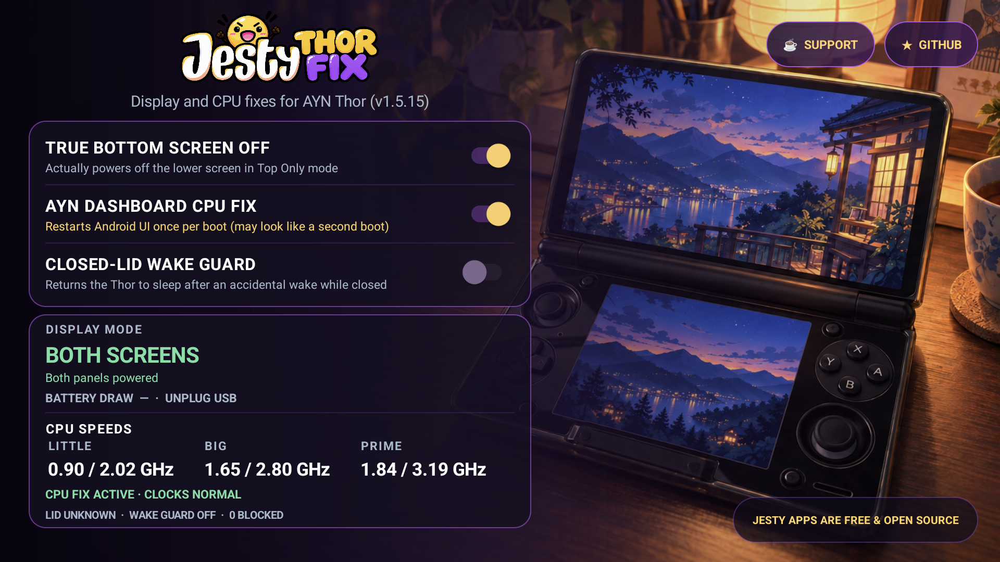

  

  <strong>Real hardware fixes for the AYN Thor.</strong> 
  Lower-screen power-off · Normal CPU idle behaviour · Closed-lid wake protection

  <a href="https://github.com/JestyLabs/Jesty-Thor-Fix/releases/tag/v1.7.0"><strong>Download v1.7.0</strong></a>
  · <a href="#what-it-fixes">Features</a>
  · <a href="#measured-on-a-real-thor">Results</a>
  · <a href="#current-investigations">Research</a>
  · <a href="https://www.buymeacoffee.com/jesty">☕ Support</a>

  
  
  

  Signed releases · Tested on a physical Thor · Fixes keep working after you close the app

  

---

### What it fixes

| Control | What it does |
|---------|--------------|
| **True Bottom Screen Off** | Powers down the lower physical display in TOP mode instead of leaving it active behind a black image. Repairs the state after sleep/wake. |
| **AYN Dashboard CPU Fix** | Stops the Dashboard from keeping the main CPU clusters stuck near their top speeds under light load. Does **not** force CPU frequencies or change governors. |
| **Closed-Lid Wake Guard** | Puts the Thor back to sleep if it wakes while the lid is still closed. Optional and **off by default**. |

Open the dashboard to see the lower screen's real hardware state, CPU speeds, estimated system power and Wake Guard status.

<strong>Diagnostics (next release candidate — not in stable v1.7.0)</strong>

The candidate dashboard adds a small **⚙ cogwheel** at the bottom-right.
Tap it to see a readable, newest-first log of app events, last known
display/CPU settings, and Android-reported app exit reasons. **Save report**
exports the original sanitized technical record for troubleshooting.

Diagnostics reuse the existing once-per-second foreground telemetry responses:
there is **no additional daemon poll or background service**. Formatting and
exit-history queries run only when opened; a small amount of app CPU and bounded
preferences I/O is incurred while the dashboard is visible. No change to the
True Bottom Screen Off or CPU Fix logic is introduced by this candidate.
Incremental diagnostic resource use is evaluated separately from the already validated display and CPU fixes.

See [Diagnostics guide](docs/APP-DIAGNOSTICS.md) and
[RC acceptance checklist](docs/APP-DIAGNOSTICS-RC-VALIDATION.md).

  

  The app dashboard running on a real AYN Thor.

---

### Measured on a real Thor

Controlled physical A/B/A testing in TOP mode showed that True Bottom Screen Off changes the lower display's hardware state and releases the CPU-cluster frequency condition observed under native TOP:

| Metric | Native TOP | True Bottom Off |
|--------|------------:|----------------:|
| Efficiency CPU cluster avg. | 2.016 GHz | 1.616 GHz |
| Performance CPU cluster avg. | 2.707 GHz | 1.654 GHz |
| Performance CPU samples near max | 75/75 | 0/45 |
| Observed system power proxy | ~2.03 W | ~1.24 W |

**[Full benchmark with sanitized raw CSVs](docs/BENCHMARKS.md)** · [Physical display/CPU checks](docs/DEVICE-VALIDATION.md)

### Hardware-validated background efficiency

We measure performance on the real device rather than inferring it from the code.

| Test | Verified result |
|---|---|
| **Watcher optimization** | **89.41% less daemon CPU in BOTH** and **89.06% less in TOP** in controlled v1.6.0-versus-candidate hardware A/B |
| **RC2 idle — BOTH** | **0.2894% of one core**, median of three ~183 s windows |
| **RC2 idle — TOP** | **0.3223% of one core**, median of three ~183 s windows |
| **RC2 suspend — BOTH** | **743.2–743.6 s** of calculated Android suspend during a quiet-sleep test |
| **RC2 suspend — TOP** | **750.6–751.0 s** of calculated Android suspend during a quiet-sleep test |
| **Code76 CPU idle — BOTH** | **0.0879% of one core**, median across three physical windows (**69.6% below RC2**) |
| **Code76 CPU idle — TOP** | **0.3172% of one core**, median across three physical windows (within the established low-overhead range) |

These figures cover separately identified builds. The signed **v1.7.0** release passed its own physical acceptance; the test-only **code76** candidate also passed in-place handoff, CPU Fix confirmation, BOTH/TOP checks and short sleep/wake. Its long-suspend testing continues.

**[Browse the official validation dossier](docs/VALIDATION-EVIDENCE.md)** · [RC2 complete baseline](docs/evidence/RC2-PHYSICAL-BASELINE-2026-10-12.md) · [Code76 physical measurements](docs/evidence/CODE76-PHYSICAL-VALIDATION-2026-10-12.md)

<strong>How the hardware results were verified</strong>

- Physical display-pipeline state was observed during TOP/BOTH and sleep/wake testing.
- CPU consumption was calculated from process CPU ticks across repeated, controlled intervals.
- Android elapsed-time and uptime clocks measured sustained suspend in both modes.
- Version, identity, firmware and device condition checks were captured alongside the tests.
- Sanitized data and source methods are linked in the dossier; proprietary firmware extracts and private device logs are not included.

---

### Current investigations

We're also exploring a few improvements. **These remain research, not supported fixes in v1.7.0.**

- **🖥️ 120 Hz / screen tearing** — Investigating display issues when the two screens use different refresh rates.
- **🔌 Device-service reliability** — Investigating a case where a built-in Thor service became unavailable.
- **🎮 TOP-mode focus** — Checking whether games can lose focus when only the upper screen is in use.

---

### How to use

1. [Download the latest signed APK](https://github.com/JestyLabs/Jesty-Thor-Fix/releases/tag/v1.7.0)
2. Install and open **Jesty Thor Fix**
3. Enable the controls you want
4. Close the app (or swipe it away). The fixes continue in the background.

The app uses the Thor’s own privileged bridge. No Magisk or root required.

> **CPU Fix note:** Changing this fix needs one supervised Android UI/display restart, which closes open apps and can briefly leave the screen black. On supported stock firmware, this is the verified safe application-level route; boot-time recovery runs in the normal startup window.

---

### Safety

- Does **not** write CPU frequencies, voltages, thermal limits, or firmware
- Validates the result after every change
- Automatically restores normal behaviour if something looks wrong
- Closed-Lid Wake Guard is off by default
- Background efficiency, wake recovery and exact signed-build acceptance are covered by [physical validation data](docs/VALIDATION-EVIDENCE.md).

More details on resource use and known limitations are in the documentation below.

---

### Compatibility

| Device | Status |
|--------|--------|
| **AYN Thor** | Supported (tested on Android 13 firmware `TKQ1.231222.001`) |
| **Retroid Pocket Duo** | Research / testers wanted — not supported yet |
| Other devices | Unsupported |

---

### Roadmap

Beyond the investigations above, the next priorities are:

- **Retroid Pocket Duo feasibility** — research and volunteer hardware testing, feature by feature. **Not supported yet.**
- **More edge-case coverage** — BOTTOM-only/dock behaviour, external-display and lid transitions, updater testing, and clearer hardware profiles.

Changes only move into a release after the required hardware validation. See the [full roadmap](docs/ROADMAP.md).

---

### Support the project

Jesty Thor Fix is free and open source. No features are locked behind donations.

  

- ⭐ Star the repository so other Thor owners can find it
- 🧪 Share results from another firmware
- 🐛 Report reproducible issues
- 💬 Join the original [Reddit discussion](https://www.reddit.com/r/AynThor/comments/1wrsmmo/found_two_weird_ayn_thor_issues_top_only_doesnt/)

---

### Documentation

[Physical validation & performance evidence](docs/VALIDATION-EVIDENCE.md) · 
[Public evidence policy](docs/PUBLIC-EVIDENCE-POLICY.md) · 
[Architecture](docs/ARCHITECTURE.md) · 
[Diagnostics](docs/APP-DIAGNOSTICS.md) ·
[Diagnostics RC validation](docs/APP-DIAGNOSTICS-RC-VALIDATION.md) · 
[Compatibility](docs/COMPATIBILITY.md) · 
[Benchmarks](docs/BENCHMARKS.md) · 
[Release notes](docs/RELEASE-NOTES-1.7.0.md) ·
[Build from source](docs/BUILD-AND-RELEASE.md) · 
[Release integrity](docs/RELEASE-INTEGRITY.md)

<strong>Technical implementation</strong>

Jesty Thor Fix follows the physical TOP/BOTH switch. It waits for Android and both displays to settle, then verifies the hardware state (CRTC).

The CPU Fix applies the tested Thor-side setting and performs its required one-time Android display-component recovery.

Closed-Lid Wake Guard performs a guarded sleep request only after verifying the current lid and device state.

See [Architecture](docs/ARCHITECTURE.md) for the full service, daemon, verification and boot behaviour.

<strong>License, provenance & independence</strong>

- Source & build scripts: [GPL-3.0](LICENSE)
- Branding & artwork: [ASSETS-LICENSE.md](ASSETS-LICENSE.md)
- Third-party notices: [THIRD_PARTY_NOTICES.md](THIRD_PARTY_NOTICES.md)
- Project provenance & attribution: [NOTICE](NOTICE.md) · [research ledger](PROVENANCE.md)
- AI assistance: [full disclosure](AI_DISCLOSURE.md)

Independent community project. Not affiliated with or endorsed by AYN.  
Hardware claims are based on physical device evidence.

