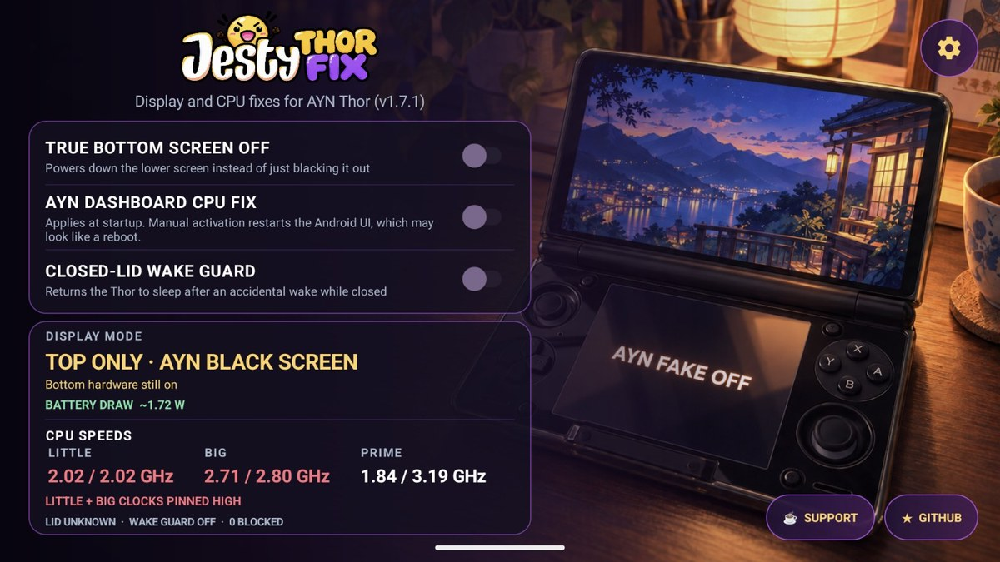
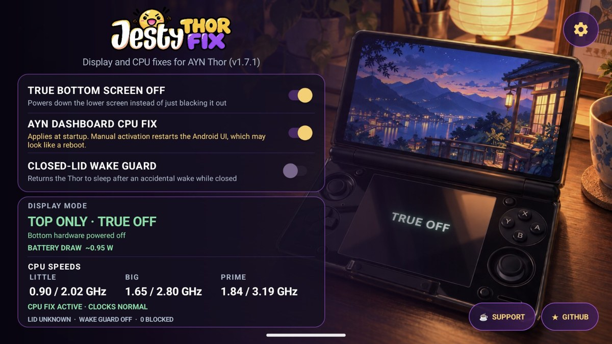
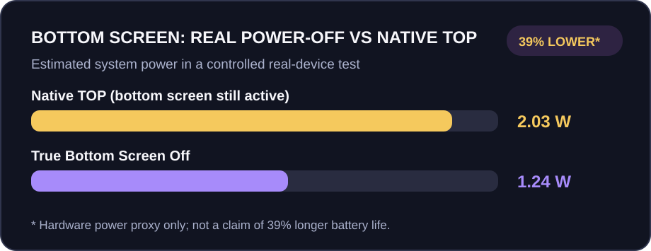
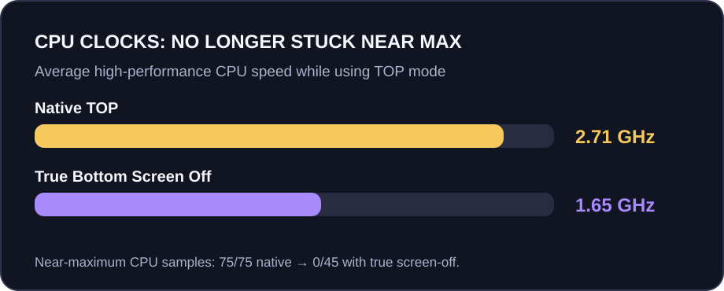
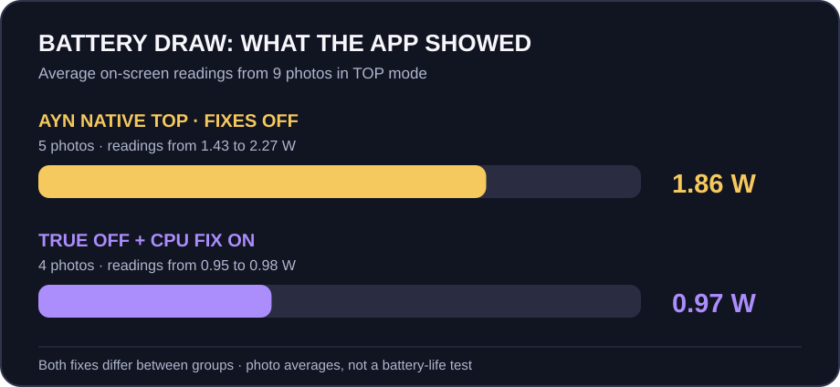

  

  <strong>Two verified AYN Thor fixes. One lightweight app.</strong> 
  Really turn off the lower display hardware in TOP mode instead of leaving it black, 
  and stop the AYN Dashboard CPU clock-pinning bug. Optional closed-lid protection included.

  <a href="https://github.com/JestyLabs/Jesty-Thor-Fix/releases/tag/v1.7.3"><strong>Download v1.7.3</strong></a>
  · <a href="#what-it-fixes">Features</a>
  · <a href="#measured-on-a-real-thor">Results</a>
  · <a href="#current-investigations">What's next</a>
  · <a href="https://www.buymeacoffee.com/jesty">☕ Support</a>

  
  
  
  
  
  

  Signed releases · Tested on a physical Thor · Works with the app closed

<table>
  <tr>
    <th align="center">AYN NATIVE TOP · FIXES OFF</th>
    <th align="center">TRUE OFF + CPU FIX ON</th>
  </tr>
  <tr>
    <td align="center"></td>
    <td align="center"></td>
  </tr>
</table>

v1.7.1 screenshots from the same Thor: both fixes OFF, about 1.72 W; both fixes ON, about 0.95 W. These are on-screen snapshots of two different configurations, not an isolated battery-life measurement or a claim that either switch alone caused the full difference.

<strong>Lightweight and safety-focused.</strong> In physical idle tests, the daemon used around <strong>0.09% of one CPU core in BOTH</strong> and <strong>0.32% in TOP</strong> (tested v1.7.1 candidate). It does not change CPU frequencies, voltages, thermal limits or firmware, and verifies the display state after applying a fix. <a href="docs/evidence/CODE76-PHYSICAL-VALIDATION-2026-10-12.md">Performance evidence</a> · <a href="docs/VALIDATION-EVIDENCE.md">Safety and validation</a>.

---

### What it fixes

| Feature | Why it matters |
|---|---|
| **True Bottom Screen Off** | The Thor's native TOP-only mode can leave the lower display pipeline running behind a black image. **Jesty turns that hardware path off**, checks the lower DRM CRTC, restores the normal state in BOTH and repairs it after ordinary wake cycles. |
| **AYN Dashboard CPU Fix** | Corrects the reproduced **LITTLE/BIG CPU clock pinning** associated with AYN Dashboard, including in BOTH/single-screen use. It is a separate fix: no manual clock, voltage or governor tuning. |
| **Closed-Lid Wake Guard (optional)** | A guarded attempt to return the Thor to sleep after an unexpected closed-lid wake. **OFF by default**; normal Guard-ON wake recovery was tested, but active unwanted-wake interception has not yet been observed. |

**What makes Jesty different?** To our knowledge, Jesty Thor Fix is **the only publicly documented AYN Thor utility that verifies a hardware-level lower-display-off state and also fixes the Dashboard CPU clock-pinning problem**. Selecting native TOP Only or merely showing a black image is not the same as deactivating the lower display pipeline. Both main fixes have [physical validation](docs/VALIDATION-EVIDENCE.md); we do not claim an exhaustive audit of unpublished/private tools. [How the two fixes differ from stock behaviour](docs/WHAT-JESTY-FIXES.md).

The two main fixes are independently selectable and continue working with the dashboard closed.

---

### Measured on a real Thor

**This is a hardware-state change, not a black overlay.** On the tested Thor, TOP true-off was confirmed by the vendor power flag and an inactive lower DRM CRTC; BOTH restored the normal active pipeline. The independent CPU Fix was also tested with both displays active. These observations establish the documented hardware states, not zero measured electrical consumption inside every panel component.

#### Controlled A/B/A benchmark

The September 2026 test used repeated, logged 1-second samples under matched conditions. The results below are **system-power proxy** measurements, not a direct battery-life test.

  

**About 39% lower estimated system-power draw in this short A/B/A comparison** of native TOP versus Jesty true-off. This is a *power proxy* from the Thor's hardware readings, **not** a direct battery-life measurement, a universal saving or an isolated measurement of the Dashboard CPU switch. Brightness, workload and charging conditions affect real-world results.

  

**From stuck-near-maximum to normal clock behaviour in the measured configurations:** **75/75** native TOP samples were near the performance cluster's maximum speed, versus **0/45** in true-off. The separately validated Dashboard CPU Fix also resolved pinning with BOTH active; do not read this historical TOP A/B/A chart as a CPU-Fix-only benchmark.

#### v1.7.1: the difference at a glance

A simpler look at the **battery-draw readings visible in nine TOP-mode photographs**. The bars show the average of the on-screen values in each configuration, with the observed ranges beneath.

  

These are snapshots of different fix configurations, not a controlled battery-life test. The separately documented A/B/A benchmark above provides the controlled comparison.

**[Full A/B/A benchmark and raw measurements](docs/BENCHMARKS.md)** · [How display power-off was validated](docs/DEVICE-VALIDATION.md)

### Lightweight in the background

The app's own CPU usage stays tiny, too. In separate physical idle tests, daemon CPU use with **both screens active** fell from about **0.29% to 0.09% of one CPU core** — around **70% less than the earlier RC2 candidate**. In TOP mode it remained around **0.32% of a core**.

[View the full hardware validation dossier](docs/VALIDATION-EVIDENCE.md) · [CPU and sleep measurements](docs/evidence/CODE76-PHYSICAL-VALIDATION-2026-10-12.md)

---

### Updating to v1.7.3

Updates can now transfer the background service automatically **without a device reboot when the existing service and device state can be verified as safe**. If the transfer cannot be completed safely, the app keeps the guarded restart/recovery path instead of forcing a process replacement. Install over the existing version without clearing data, open the app, and wait for **ACTIVE** or **STOCK**. For more information, see [What changed in v1.7.3](docs/RELEASE-NOTES-1.7.3.md).

### Current investigations

We are still looking into the following areas. **These are research, not advertised fixes in v1.7.3.**

- **🖥️ Pre-existing Thor 120 Hz / screen tearing** — A device/firmware mixed-refresh problem **not introduced by Jesty Thor Fix**. We are investigating it, **not claiming a fix**. The physical cause and any safe remedy remain unproven. [Research #37](https://github.com/JestyLabs/Jesty-Thor-Fix/pull/37).
- **🔌 Device-service reliability** — Investigating rare cases where Android temporarily loses access to a built-in device service.
- **🎮 TOP-mode game focus** — Checking reports of games losing focus when the bottom screen is off.
- **⚡ Further efficiency and reliability** — More hardware edge cases, safer recovery and precise profiling. [Engineering hardening PR #67](https://github.com/JestyLabs/Jesty-Thor-Fix/pull/67) is merged and included in the current release.

Interested in future device support, including Retroid Pocket Duo? That's **research only** and requires separate volunteer hardware testing — it is **not supported** today. [Full roadmap](docs/ROADMAP.md).

---

### How to use

1. **[Download Jesty Thor Fix v1.7.3](https://github.com/JestyLabs/Jesty-Thor-Fix/releases/tag/v1.7.3)** (official signed APK).
2. Install normally over the existing version **without uninstalling or clearing app data**; open **Jesty Thor Fix**.
3. Allow the background service to transfer and confirm **ACTIVE** or **STOCK**. If transfer is unavailable, follow the app’s safe fallback guidance.
4. Enable the controls you want. You can close the app; the fixes keep working in the background.

The app uses the Thor’s own privileged bridge. No Magisk or root required.

> **CPU Fix note:** Turning this fix on or off restarts the Android interface once. Open apps may close, and the screen can briefly go black. This is not a full device reboot.

---

### Safety-first design

**Built for stock AYN Thor hardware — no overclocking, firmware flashing, Magisk or manual rooting required.**

- **No CPU or thermal tuning:** does not write CPU frequencies, voltages or thermal limits.
- **Verified changes:** checks the hardware display state after applying the fix.
- **Guarded display reconciliation:** verifies the lower CRTC and recovers from tested normal wake transitions; [rare persistent TOP wake black screens](https://github.com/JestyLabs/Jesty-Thor-Fix/issues/84) are still under investigation.
- **Optional protection:** Closed-Lid Wake Guard is OFF by default; its active interception of an unintended wake is not yet physically demonstrated.

The safety mechanisms, physical tests and known limitations are documented in the [validation evidence](docs/VALIDATION-EVIDENCE.md) and [architecture](docs/ARCHITECTURE.md).

---

### Compatibility

| Device | Status |
|--------|--------|
| **AYN Thor** | Supported (tested on Android 13 firmware `TKQ1.231222.001`) |
| **Retroid Pocket Duo** | Research / testers wanted — not supported yet |
| Other devices | Unsupported |

---

### Support the project

Jesty Thor Fix is free and open source. No features are locked behind donations.

  

- ⭐ Star the repository so other Thor owners can find it
- 🧪 Share results from another firmware
- 🐛 Report reproducible issues
- 💬 Join the original [Reddit discussion](https://www.reddit.com/r/AynThor/comments/1wrsmmo/found_two_weird_ayn_thor_issues_top_only_doesnt/)

---

### Documentation

[What Jesty fixes (and what it does not)](docs/WHAT-JESTY-FIXES.md) ·
[Physical validation & performance evidence](docs/VALIDATION-EVIDENCE.md) · 
[Public evidence policy](docs/PUBLIC-EVIDENCE-POLICY.md) · 
[Architecture](docs/ARCHITECTURE.md) · 
[Diagnostics](docs/APP-DIAGNOSTICS.md) ·
[Diagnostics RC validation](docs/APP-DIAGNOSTICS-RC-VALIDATION.md) · 
[Compatibility](docs/COMPATIBILITY.md) · 
[Benchmarks](docs/BENCHMARKS.md) · 
[What's new in v1.7.3](docs/RELEASE-NOTES-1.7.3.md) ·
[Build from source](docs/BUILD-AND-RELEASE.md) · 
[Release integrity](docs/RELEASE-INTEGRITY.md)

<strong>Technical implementation</strong>

Jesty Thor Fix follows the physical TOP/BOTH switch. It waits for Android and both displays to settle, then verifies the hardware state (CRTC).

The CPU Fix applies the tested Thor-side setting and performs its required one-time Android display-component recovery.

Closed-Lid Wake Guard performs a guarded sleep request only after verifying the current lid and device state.

See [Architecture](docs/ARCHITECTURE.md) for the full service, daemon, verification and boot behaviour.

<strong>License, provenance & independence</strong>

- Source & build scripts: [GPL-3.0](LICENSE)
- Branding & artwork: [ASSETS-LICENSE.md](ASSETS-LICENSE.md)
- Third-party notices: [THIRD_PARTY_NOTICES.md](THIRD_PARTY_NOTICES.md)
- Project provenance & attribution: [NOTICE](NOTICE.md) · [research ledger](PROVENANCE.md)
- AI assistance: [full disclosure](AI_DISCLOSURE.md)

Independent community project. Not affiliated with or endorsed by AYN.  
Hardware claims are based on physical device evidence.

